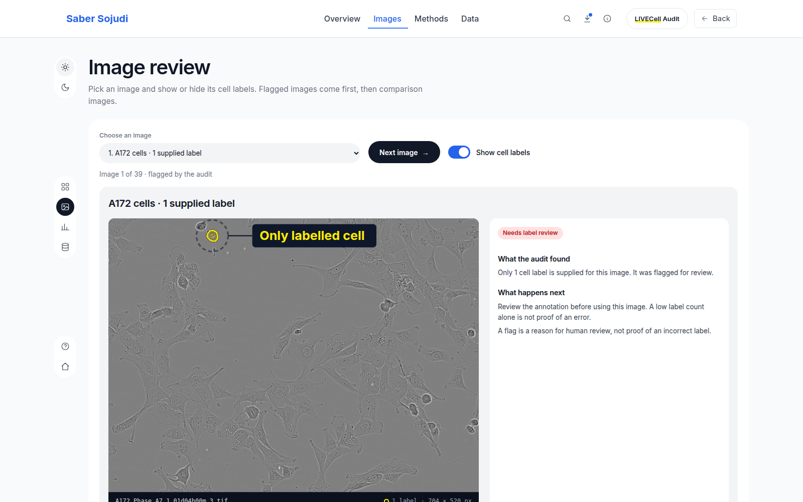
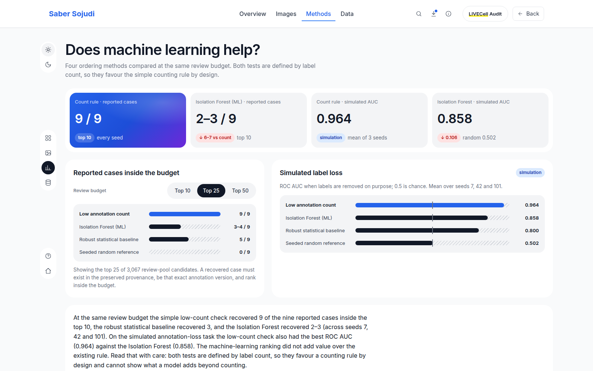
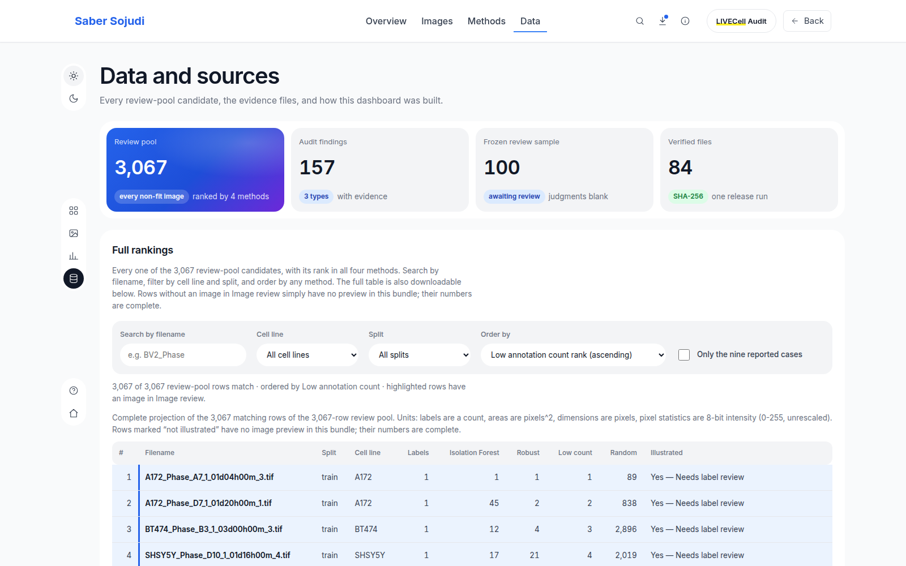
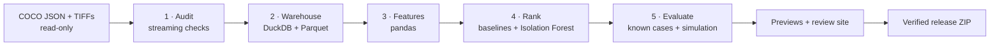

<div align="center">

# LIVECell Audit

**A reproducible data-quality audit of the public LIVECell cell-image dataset, with a review dashboard that explains the results in plain language.**

[**▶ Open the live dashboard**](https://sabersojudi.com/livecell-audit/) · [Findings](docs/02_upstream_bugs_and_findings.md) · [Method and model card](docs/09_model_card.md) · [Release process](docs/12_release.md)


[](https://sabersojudi.com/livecell-audit/)

</div>

---

## Why this exists

To teach an AI model to recognise cells, scientists outline the cells in microscope images by hand. If those outlines are missing, duplicated or in the wrong group, the model learns from bad examples and its scores look better than they really are.

LIVECell is a public dataset of 5,239 phase-contrast images and over 1.6 million hand-drawn cell outlines (Edlund et al., *Nature Methods* 2021). This project checks those labels before they are used, ranks the images most worth a second look, and shows each result next to the image it comes from.

## What the audit found

All numbers are reproduced from the raw COCO annotation files. The dashboard re-derives every one of them from the same verified run.

| | Result | What it means |
|---|---:|---|
| 🔬 **Cell labels checked** | **1,662,447** | across 5,387 image records; 0 images missing |
| 🖼️ **Images audited** | **5,239** | every distinct file matched to a local copy |
| 🔁 **Reused photos** | **30** | the same photo is in both the training and the validation group (5.3% of validation), which inflates validation scores |
| ⚠️ **Sparse-label images** | **9** | 10 or fewer labels on images full of cells; all 9 are recovered as review candidates |
| 📑 **Alternate label versions** | **118** | the same photo recorded more than once within a group; the authors kept these on purpose, so they need a policy, not a deletion |

The reused photos and the sparse labels were first reported by the community on GitHub ([#26](https://github.com/sartorius-research/LIVECell/issues/26), [#21](https://github.com/sartorius-research/LIVECell/issues/21)). The authors explained the alternate versions in [#14](https://github.com/sartorius-research/LIVECell/issues/14). This project does not claim to have discovered them. It reproduces them from the raw files, tracks them with evidence, and turns them into a check that can be run again. Details: [`docs/02_upstream_bugs_and_findings.md`](docs/02_upstream_bugs_and_findings.md).

| Split | Image records | Distinct photos | Extra records | Cell labels |
|---|---:|---:|---:|---:|
| Training | 3,253 | 3,188 | 65 | 1,018,576 |
| Validation | 570 | 569 | 1 | 181,610 |
| Test | 1,564 | 1,512 | 52 | 462,261 |

## Does machine learning help?

I compared four ways of ordering 3,067 images for human review, all with the same review budget (the top 10, 25 or 50 images):

| Method | Reported cases in the top 10 | Simulated label loss (ROC AUC) |
|---|---:|---:|
| **Low label count** (simple rule) | **9 / 9** | **0.964** |
| Robust statistical baseline | 3 / 9 | 0.800 |
| Isolation Forest (ML) | 2–3 / 9 | 0.858 |
| Seeded random reference | 0 / 9 | 0.502 |

**The simple rule won.** Both tests are defined by label count, so they favour counting by design and cannot show what a model adds beyond it. The Isolation Forest flags *unusual* images, which is not the same as images whose labels are wrong. I report this result as it is and keep the ML ranking as a second, independent opinion. Full results: [`docs/10_ranking_evaluation.md`](docs/10_ranking_evaluation.md).

## The dashboard

A static website with no backend and no tracking, hosted at **[sabersojudi.com/livecell-audit](https://sabersojudi.com/livecell-audit/)**. It also opens straight from `file://`.

| Image review | Method comparison |
|---|---|
| [](https://sabersojudi.com/livecell-audit/#try-it) | [](https://sabersojudi.com/livecell-audit/#results) |
| 39 real microscope images. Show or hide the supplied labels; flagged images come first. | KPI tiles and charts for the four methods; switch the budget between Top 10, 25 and 50. |

[](https://sabersojudi.com/livecell-audit/#data)

**Data and sources:** all 3,067 candidates with their rank in every method, searchable and filterable, plus the evidence files to download.

Every figure on the page is copied from the release run's verified outputs. `tools/check_review_site.py` re-derives them and checks every link (1,120 checks in the reference run). Design notes: [`DESIGN.md`](DESIGN.md) and [`docs/11_review_interface.md`](docs/11_review_interface.md).

## How it works



1. **Audit:** streams the ~909 MB of COCO JSON without loading it into memory. It checks files, dimensions, filenames, overlaps between groups, duplicate records and label counts, and writes 157 findings, each with its evidence and a recommended next step.
2. **Warehouse:** loads the audit into DuckDB with typed Parquet exports and versioned SQL views, and reconciles every row count and join.
3. **Features:** builds one documented feature row per image record from label statistics, acquisition metadata and image texture. Every feature has a source, formula, unit and missing-value rule in [`docs/09_data_contract.md`](docs/09_data_contract.md).
4. **Rank:** a fit-only Isolation Forest (seed 42) alongside simple baselines, applied at review budgets of 10, 25 and 50.
5. **Evaluate:** a regression check on the 9 reported cases, a synthetic label-removal experiment over 3 seeds, and a frozen 100-image sample for a scientist to judge.

Every stage refuses input without a valid `COMPLETED` marker and matching hashes, so a partial or swapped output is never consumed. Outputs are deterministic: running again on the same input gives byte-identical files.

## Quickstart

Requirements: Python 3.12, about 1 GB of free memory, and the LIVECell data (~2.1 GB, see `scripts/download_data.sh`).

```bash
python3 -m venv .venv
.venv/bin/pip install -r requirements-dev.txt

# view the dashboard locally (no build step)
python3 -m http.server --directory web/review 8321
```

**Run the whole chain in one command** into a new, immutable run directory, finishing with a portable, verified ZIP:

```bash
tools/run_release.sh --data-root data/raw --out-root data/runs   # audit → … → site → package
tools/run_release.sh validate --data-root data/raw               # preflight only
tools/run_release.sh verify-package --zip <release.zip>          # re-verify an archive
```

<details>
<summary><b>Run the stages one by one</b></summary>

```bash
export PYTHONPATH=src
.venv/bin/python -m livecell_audit audit     --data-root data/raw --out-dir data/workbench/audit
.venv/bin/python -m livecell_audit warehouse --audit-dir data/workbench/audit --out-dir data/workbench/warehouse --data-root data/raw
.venv/bin/python -m livecell_audit features  --warehouse-dir data/workbench/warehouse --data-root data/raw --out-dir data/workbench/features
.venv/bin/python -m livecell_audit rank      --features-dir data/workbench/features --warehouse-dir data/workbench/warehouse --out-dir data/workbench/ranking
.venv/bin/python -m livecell_audit evaluate  --features-dir data/workbench/features --warehouse-dir data/workbench/warehouse \
                                             --ranking-dir data/workbench/ranking --out-dir data/workbench/evaluation

# tests: fixtures everywhere, plus the full-dataset check when the data is present
.venv/bin/python -m pytest tests/ -q
LIVECELL_DATA_ROOT=data/raw .venv/bin/python -m pytest tests/test_integration.py -q
```

</details>

<details>
<summary><b>What a release run guarantees</b></summary>

- **Immutable run IDs:** `<UTC timestamp>-<input hash>`, derived from the COCO files' SHA-256 and the image inventory. An existing run directory is never reused, and a failed run is kept for inspection.
- **Per-stage records:** the exact command, configuration, seeds, input identity, output hashes, wall time and peak memory for each stage.
- **Completion last:** the run is marked complete only after `verify-chain` re-checks every marker, manifest and output hash (92 chain checks in the reference run).
- **A clean package:** the ZIP contains the site, tables, model card, docs, provenance and receipt. Raw images, the database, model binaries and absolute or private paths are excluded by an automatic scan, and every link is re-resolved after unzipping.

Reference run `20261018T231214Z-0e359b9bf088`, with each stage under a memory cap:

| Stage | audit | warehouse | features | ranking | evaluation | previews |
|---|---:|---:|---:|---:|---:|---:|
| Time | 44 s | 14 s | 99 s | 29 s | 13 s | 22 s |
| Peak memory | 199 MB | 326 MB | 275 MB | 340 MB | 350 MB | 60 MB |

See [`docs/12_release.md`](docs/12_release.md).

</details>

## Repository layout

```text
src/livecell_audit/   audit + streaming COCO reader, warehouse (DuckDB), features (pandas),
                      ranking (baselines + Isolation Forest), evaluation, CLI
tests/                fixture tests for every stage and the release tooling, plus a full-data check
tools/                run_release.sh, release_tools.py, build_review_site.py,
                      make_previews.py, check_review_site.py
web/review/           the dashboard, built from the reference release run
docs/                 findings, data contract, model card, evaluation, interface, release,
                      upstream issue snapshots, README screenshots
data/, releases/      gitignored: raw data, runs and packages
```

## Limitations

- Duplicates are matched by filename, not by pixels; near-duplicate photos are out of scope.
- A low label count is a reason for review, not proof of an error. How often a flag is a real labelling problem is unmeasured until a scientist reviews the frozen 100-image sample.
- The Isolation Forest mixes label statistics with image texture. Three of its 24 features are constant on LIVECell, because every image is 704 × 520.
- No cell-segmentation model is trained here, and no effect on segmentation accuracy is claimed.
- The dashboard was tested in Chromium (desktop and phone width); no user study has been done.

## Credit

- **Dataset:** LIVECell by Sartorius Corporate Research (Edlund et al., *Nature Methods* 2021), CC BY-NC 4.0, [`sartorius-research/LIVECell`](https://github.com/sartorius-research/LIVECell).
- **Upstream reports:** reused photos (#26) by `OasisArtisan`; incomplete labels (#21) by `ivan-ea`, with a reply from Rickard Sjögren (Sartorius); the dual-annotation explanation (#14) by Christoffer Edlund (Sartorius).
- **Audit code and dashboard:** [Saber Sojudi](https://sabersojudi.com) (2026), for non-commercial research, portfolio and educational use. This is an independent project, not affiliated with Sartorius.
