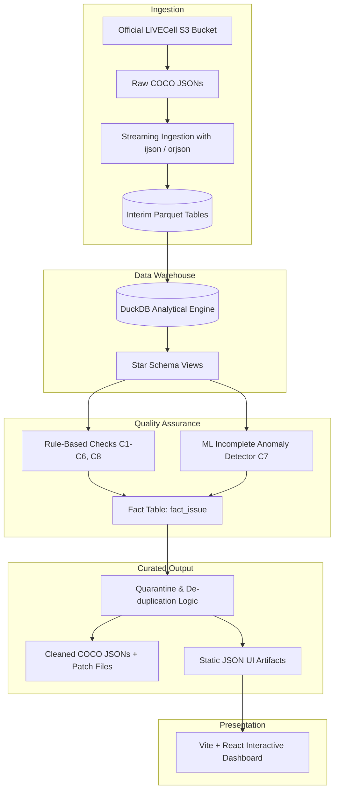

# 03. Architecture & Data Pipeline Specification

## 1. System Architecture

The pipeline processes raw COCO JSON files, ingests them into high-performance columnar formats, executes a battery of 8 automated quality checks, trains an anomaly detection model for incomplete annotations, and exports clean datasets and UI reporting contracts.

---

## 2. DuckDB Analytical Star Schema

To allow fast SQL querying and analytical exploration, the data is structured into a clean dimensional star schema:

### `dim_image`
| Column | Type | Description |
|---|---|---|
| `image_id` | BIGINT (PK) | Original integer image identifier |
| `file_name` | VARCHAR | Base filename (e.g. `Huh7_Phase_A10_2_00d16h00m_4.tif`) |
| `split` | VARCHAR | Original split (`train`, `val`, `test`) |
| `cell_line` | VARCHAR | Parsed cell line (e.g. `Huh7`, `SKOV3`, `A172`) |
| `well` | VARCHAR | Microplate well (e.g. `A10`, `H4`) |
| `time_hours` | DOUBLE | Extracted incubation time in hours (from `XXdYYhZZm`) |
| `field_id` | INT | Spatial field index within the well |
| `width` | INT | Image width (704 px) |
| `height` | INT | Image height (520 px) |
| `pixel_hash` | VARCHAR | SHA-256 hash of raw image pixel payload |

### `dim_cell_line`
| Column | Type | Description |
|---|---|---|
| `cell_line` | VARCHAR (PK) | Canonical cell line name |
| `morphology` | VARCHAR | Biological morphology (e.g. epithelial, glial, neuroblast) |
| `growth_type` | VARCHAR | Adherent / semi-adherent |

### `fact_annotation`
| Column | Type | Description |
|---|---|---|
| `annotation_id` | BIGINT (PK) | Annotation identifier |
| `image_id` | BIGINT (FK) | Reference to `dim_image.image_id` |
| `area` | DOUBLE | Labeled mask pixel area |
| `bbox_x` | DOUBLE | Bounding box top-left x |
| `bbox_y` | DOUBLE | Bounding box top-left y |
| `bbox_w` | DOUBLE | Bounding box width |
| `bbox_h` | DOUBLE | Bounding box height |
| `num_vertices` | INT | Total polygon vertices count |
| `is_valid_poly` | BOOLEAN | Polygon topological validity flag |

### `fact_issue`
| Column | Type | Description |
|---|---|---|
| `issue_id` | VARCHAR (PK) | Unique issue instance hash |
| `check_code` | VARCHAR | Check identifier (`C1` through `C8`) |
| `severity` | VARCHAR | `CRITICAL`, `WARNING`, `INFO` |
| `image_id` | BIGINT | Affected image record (nullable) |
| `file_name` | VARCHAR | Affected filename |
| `annotation_id` | BIGINT | Affected annotation record (nullable) |
| `description` | VARCHAR | Diagnostic detail |

### `mart_well_growth` (Scientist-Facing Time Series)
| Column | Type | Description |
|---|---|---|
| `cell_line` | VARCHAR | Cell line identifier |
| `well` | VARCHAR | Plate well coordinate |
| `time_hours` | DOUBLE | Timepoint in culture |
| `cell_count` | INT | Total segmented cells |
| `total_cell_area` | DOUBLE | Cumulative segmented area |
| `confluence_ratio` | DOUBLE | `total_cell_area / (704 * 520)` |
| `anomaly_score` | DOUBLE | Growth rate discontinuity score |

---

## 3. The 8 Automated Quality Checks (C1 – C8)

| Check Code | Check Name | Target Bug / Vulnerability | Logic & Detection Rule |
|---|---|---|---|
| **C1** | **Schema & Parse Integrity** | Issues #4, #9, #12, #23 | Validates required COCO keys (`info`, `images`, `annotations`, `categories`) using strict Pydantic schemas. Detects truncated JSONs. |
| **C2** | **File Reconciliation** | Issues #1, #14 | Bidirectional join: verifies all `file_name` entries in JSON exist on disk, and flags any orphaned `.tif` files lacking annotations. |
| **C3** | **Intra-Split ID Duplication** | Issue #26 | Groups by `file_name` within each split. Flags any filename associated with multiple conflicting `image_id` values. |
| **C4** | **Cross-Split Data Leakage** | Issue #26 | Identifies images sharing the same `file_name` or matching pixel SHA-256 hash across `train`, `val`, and `test` partitions. |
| **C5** | **Geometric Polygon Validity** | Geometry errors | Uses `shapely.geometry.Polygon`: flags vertices < 3, self-intersecting loops (`not is_valid`), zero area, or bounding box bounding violations. |
| **C6** | **Annotation Redundancy** | Duplicate instances | Calculates Intersection over Union (IoU) across instances within an image using Spatial R-tree indexing. Flags pairs with IoU > 0.90. |
| **C7** | **Incomplete Annotation Anomaly** | Issue #21 | Multi-feature ML detection: identifies low count outliers relative to temporal confluence growth curves using `IsolationForest` and robust rolling median z-scores. |
| **C8** | **Metadata Naming Consistency** | Label integrity | Regex parsing of `file_name` against folder structure, well IDs, timepoints, and expected optical crop parameters. |

---

## 4. Incomplete Annotation ML Detector (Check C7)

### Problem
In Issue #21, annotators saved partial tiles containing only 1–2 cell polygons while the underlying culture is at 30%–80% confluence.

### Feature Extraction:
1. `segmented_cell_count`: Total cell instances labeled for image $i$.
2. `segmented_confluence`: Total labeled mask area / image area.
3. `background_intensity_std`: Standard deviation of image pixel intensities (high texture indicates presence of cells even if unannotated).
4. `expected_confluence_delta`: Difference between observed confluence and the rolling median of adjacent timepoints $(t-4\text{h}, t+4\text{h})$ for the exact same well.

### Detection Model:
- **Baseline:** Robust Z-score: $|Z| = \frac{\text{cell\_count}_t - \text{median}(\text{well})}{\text{IQR}(\text{well})} > 3.0$.
- **Model:** `sklearn.ensemble.IsolationForest(contamination=0.015, random_state=42)`.
- **Benchmark Evaluation:** The 9 known images verified in Issue #21 are held out as a positive evaluation set to verify 100% recall.
